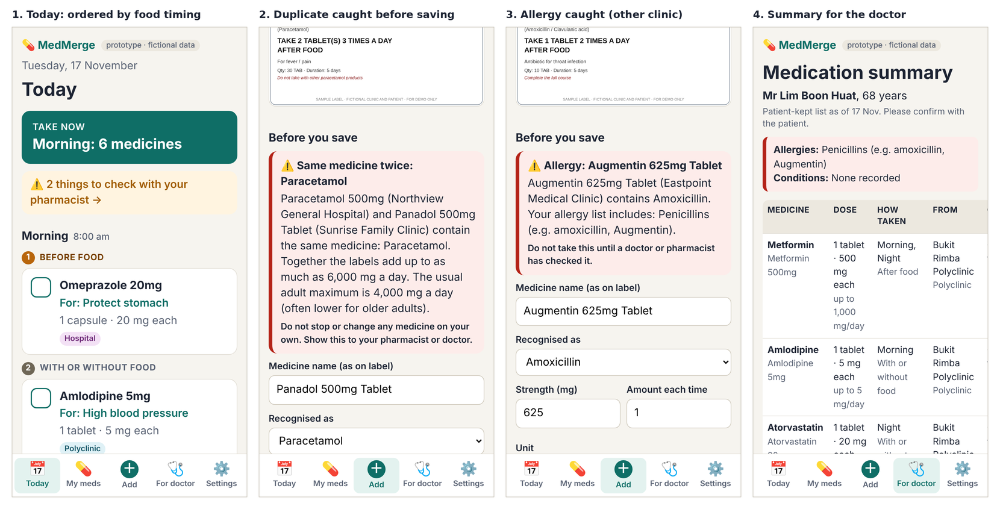
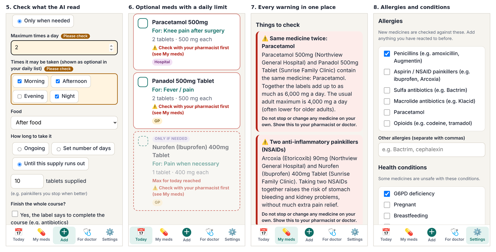

# MedMerge

**One medication list across every clinic.**

MedMerge is a prototype that lets patients scan the labels of medicines from different healthcare providers (hospitals, polyclinics, GPs and pharmacies) into one list. The list flags duplicates, clashes and allergies, shows a clear daily schedule, and produces a one-page summary for any doctor.

- **Live prototype:** https://k4i29c.github.io/MedMerge/ (works without an API key: use the sample labels on the Add page)
- All people, clinics and labels in the prototype are **fictional**. Not medical advice.



## The pain point

Patients who get medicines from several places have no single list of everything they take. An older patient might have chronic medicines from a polyclinic, painkillers from a hospital after surgery, acute medicines from a GP and over-the-counter ones from a pharmacy, each with its own bag, label and instructions. This causes three problems:

1. **Duplicates and clashes.** The same drug can arrive under different brand names (Panadol from the GP plus paracetamol from the hospital), or two medicines can interact. Doctors may not see the full list, and patients often can't remember exactly what they take.
2. **Allergies and conditions get missed.** Elderly patients visiting a new clinic may not remember exactly which medicine they are allergic to, or the name of their condition.
3. **Confusion about taking them.** When unwell, patients struggle to track what to take when, before or after food, which medicines are optional, and how long to continue.

Singapore's NEHR and HealthHub already hold medication and allergy records, and HealthHub offers reminders. The gaps are private clinics not yet fully connected, over-the-counter medicines, the same drug under different brand names, and one daily routine a patient can actually follow.

## Who it's for

- **Primary:** older adults taking medicines from several providers, such as the demo patient Mr Lim, 68 (diabetes, high blood pressure and cholesterol from the polyclinic, recent knee surgery at a hospital, now a GP visit for a cough).
- **Secondary:** doctors and pharmacists, who need a quick, complete summary of current medicines, allergies and conditions before prescribing.

## How it works

**Core workflow:** Mr Lim scans the labels from his different clinics, and the app combines them into one list that catches problems and tells him what to take when.

1. **Scan and confirm.** He photographs a label. AI reads it and shows the details back for him to check, with any fields it was unsure about highlighted. Warnings appear before he saves.
2. **One list with warnings.** Medicines are grouped by where they came from and checked for duplicates (including different brand names), two of the same type, known interactions, allergies, and conditions such as G6PD deficiency. For example, Panadol from the GP plus hospital paracetamol adds up to 6,000 mg a day, above the usual 4,000 mg maximum.
3. **A clear daily schedule.** Each time of day is ordered before food, then either, then after food. Each medicine says what it's for in plain words, and optional medicines show a daily limit. A one-page summary can be shown to any doctor.

The demo starts with Mr Lim's existing hospital and polyclinic medicines. Five fictional sample labels, from a GP visit and another clinic, show the app at work: four trigger different warnings (duplicate, same type, interaction, allergy), and one deliberately triggers none.



## Key design decisions

**AI is used only where it's good at the job, and safety decisions come from fixed rules that can be tested.**

| Decision | Why |
|---|---|
| AI only reads the label; fixed rules decide the warnings | Reading messy labels suits a vision model. Medication safety must be predictable and explainable, so it's rule-based (`js/rules.js`) and covered by unit tests. |
| The patient confirms every scan | AI output is a suggestion. Uncertain fields are highlighted for checking before saving. |
| Medicines and allergies the app can't recognise are marked "Not checked" | Silence would wrongly suggest "safe". |

## Run it

No build step. Any static server works:

```bash
python3 -m http.server 8000   # then open http://localhost:8000
```

(Opening `index.html` directly from disk won't work, because the app uses ES modules.)

**Live label scanning (optional):** open *Settings*, paste an Anthropic API key, then use *Scan a label* with a phone photo. The key is stored only in your browser, which is fine for a prototype but not for production (see below).

## Tests

```bash
npm test                                   # 20 unit tests for the safety rules and scan handling (no dependencies)
ANTHROPIC_API_KEY=sk-ant-... npm run eval  # scanner accuracy on eval/labels vs eval/expected.json
```

## Project structure

```
index.html, styles.css   UI shell and styles (mobile-first, large text)
js/app.js                screens, state (localStorage), events
js/rules.js              drug list; duplicate, same-type, interaction, allergy and condition rules; schedule helpers
js/extract.js            label-reading prompt, Claude API call, normalising the result
js/samples.js            fictional demo patient and pre-recorded sample scans
samples/                 fictional label images (generated by scripts/make_labels.py)
tests/                   unit tests
eval/                    scanner accuracy script and expected values
docs/screenshots/        screenshots
```

## Limitations and what production would need

- The warning rules are a **small example set** created for the demo, not a complete interaction or allergy check.
- Live label scanning is implemented but was tested only with demo data.
- There are unit tests, but no end-to-end tests in the repository yet.

Before production:

- **Security:** the API key is stored in and sent from the browser. Production needs a server that holds the key and calls the API.
- **Privacy:** medicines, allergies and conditions are stored unencrypted in the browser. Production needs proper accounts, encrypted storage, and handling that meets Singapore's PDPA.
- **Correctness:** drug names are matched by simple text search, so combination products may be only partly checked. Production should use a maintained, coded drug database.
- **Interoperability:** a real version should connect to Singapore's national systems, such as NEHR and HealthHub, using standard healthcare data formats.

**Next steps:** pharmacist review of the rules, end-to-end tests, and linking with HealthHub or NEHR instead of duplicating them.

## How it was built

Built with Claude (Anthropic) as the coding agent: it wrote the code and ran the tests and browser walkthroughs. I chose the problem, set the scope and safety rules, reviewed the working prototype, and directed the changes.
